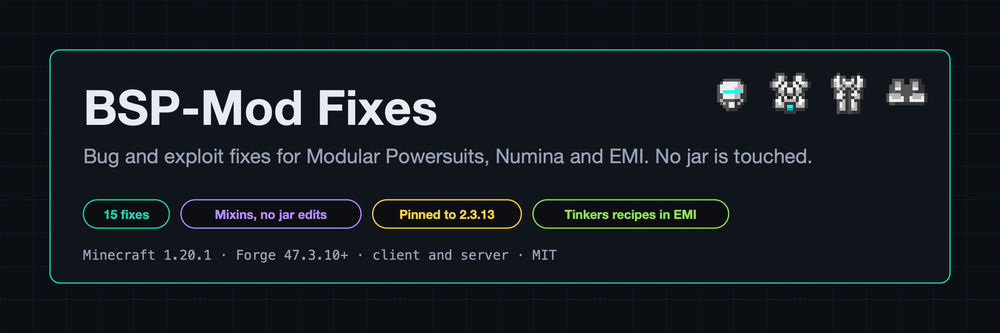
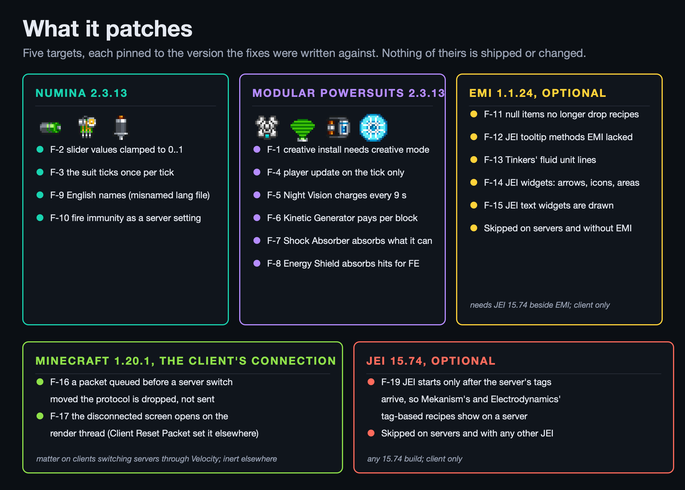
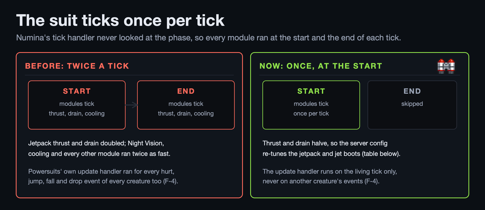
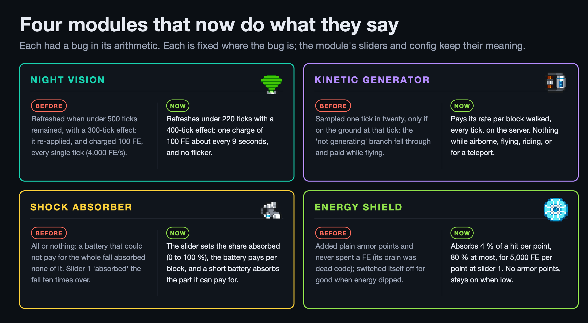
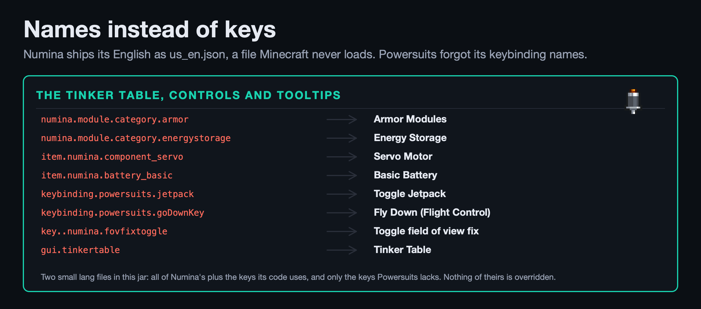
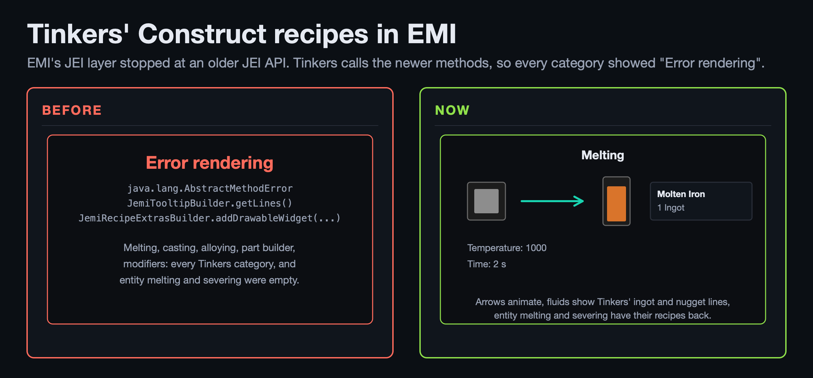
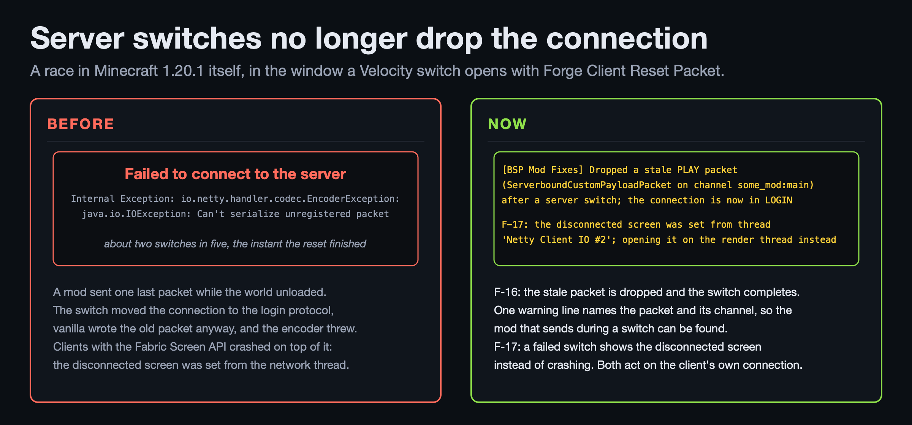
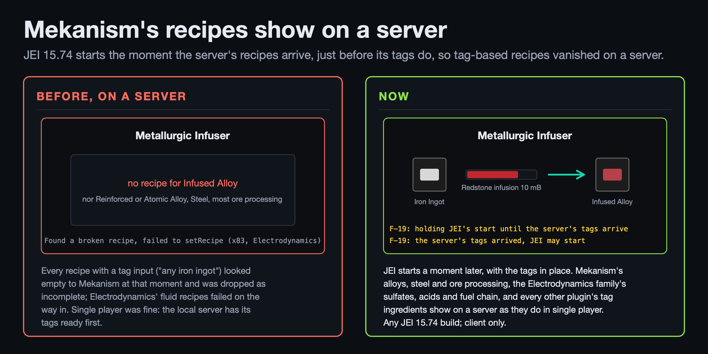
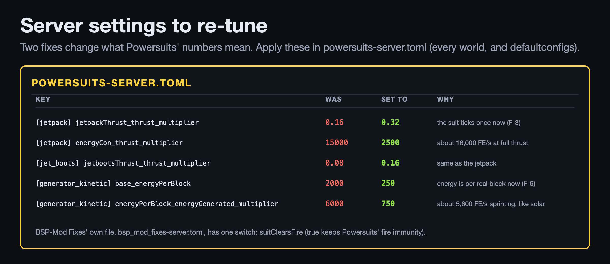
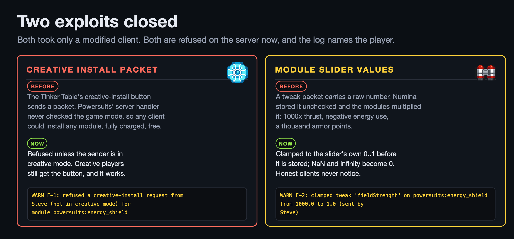

# BSP-Mod Fixes

**Bug and exploit fixes for Modular Powersuits, Numina, EMI, JEI and the client's own connection, without touching their jars.** We love the power armor in the Build Secure Protect pack, and we found it ticking twice a tick, handing out free modules to anyone with a modified client, and showing raw translation keys all over the Tinker Table. Then we found server switches dropping the connection, and Mekanism's recipes missing from JEI on a server. This mod patches all of that in place: eighteen small fixes, each one aimed at the exact line that was wrong, each one with a test. Put it next to the two mods and the suit does what its sliders say.

- Minecraft 1.20.1, Forge 47.3.10 or newer, Java 17. Needed on the client and the server.
- Requires **Numina 2.3.13** and **Modular Powersuits 2.3.13**, exactly. If either is updated the game refuses to start until this mod is updated too, so a fix is never applied to code it was not written for.
- Optional, client only: **EMI 1.1.24+1.20.1+forge** with JEI 15.74 for the Tinkers' Construct recipe fixes, and **any JEI 15.74 build** for the recipes-on-a-server fix. Without EMI or JEI, or with another version of either, those fixes are skipped and the log says so.
- The two server-switch fixes need nothing extra; they matter on clients that switch servers through a Velocity proxy with Forge Client Reset Packet and do nothing elsewhere.
- MIT licence, source on [GitHub](https://github.com/Build-Secure-Protect/BSP-Mod-Fixes). Nothing of the patched mods is shipped or changed; the patches are mixins, event handlers and two small language files.

---

## What it patches

Five targets, pinned to the versions the fixes were written against. The log lists every fix once loading is complete, with what it patches and whether it is applied, skipped, or waiting for its target to load.

---

## For players: the suit does what it says

**Once per tick.** Numina's tick handler never looked at the tick phase, and Forge fires that event twice a tick, so every module ran at the start and the end of each tick: jetpack thrust and drain doubled, Night Vision and cooling twice as fast. Now the suit ticks once. Thrust and drain halve with it, which is why the server settings below double the thrust back and cut the drain to something a battery can carry. Powersuits' own player update also ran for every hurt, jump, fall and drop event of every creature on the server; it runs on the player's tick only now.

**Night Vision** charged its 100 FE every tick, because it refreshed the effect whenever under 500 ticks remained but applied a 300-tick effect. It refreshes under 220 ticks with a 400-tick effect now: one charge about every 9 seconds, and never a flicker.

**The Kinetic Generator** sampled your walking one tick in twenty, only if you happened to be on the ground at that tick, and its "not generating" branch fell through and paid while you flew. It pays its rate for every block you walk now, every tick, and nothing while airborne, flying, riding, or for a teleport.

**The Shock Absorber** was all or nothing: if the battery could not pay for the whole fall, none of it was absorbed, which is why it "failed after jetpacking" (the jetpack had emptied the battery). The slider now sets the share of the fall absorbed, the battery pays per block, and a short battery absorbs the part it can pay for.

**The Energy Shield** added plain armor points and never spent a FE (its drain was dead code), and switched itself off for good whenever energy dipped under one hit's cost. It now absorbs part of each hit for energy, 4 % per shield point as vanilla armor does and 80 % at most, at 5,000 FE per point absorbed at slider 1. Damage that bypasses armor is untouched, plating still counts, knockback resistance stays, and the module stays on when the battery is low.

**Names instead of keys.** Numina ships its English as `us_en.json`, a file name Minecraft never loads, so every Numina name showed as its raw key; Powersuits forgot the keybinding names of its modules and a few screen titles. Two small language files in this jar fill the gaps: all of Numina's plus the keys its code uses, and only the keys Powersuits lacks, so nothing of theirs is overridden.

---

## Tinkers' Construct recipes in EMI

EMI's JEI compatibility layer stopped at an older JEI API, and Tinkers' Construct calls the newer methods, so every Tinkers category in EMI showed "Error rendering" with a stack trace for a tooltip, and entity melting and severing were empty. With EMI 1.1.24 and JEI 15.74 beside this mod, the missing methods are there: tooltips can be edited the way Tinkers edits them, so a fluid shows "1 Ingot" instead of a duplicated "1,000 mB" line; arrows, icons, tooltip areas and text widgets are drawn; and a recipe with an entity that has no spawn egg no longer drops the whole category. These five fixes apply only when that exact EMI is present and only on the client; a server or a player without EMI loads the mod as before.

---

## Server switches no longer drop the connection

Switching servers through Velocity with Forge Client Reset Packet sometimes ended in "Internal Exception: io.netty.handler.codec.EncoderException: java.io.IOException: Can't serialize unregistered packet" the instant the reset finished, about two switches in five. The cause is a race in Minecraft 1.20.1 itself: a packet a client mod sent while the world was unloading was queued for the old protocol, the reset moved the connection to the login protocol, and vanilla then wrote the old packet anyway. Such a packet is dropped now, with one warning line in the client log naming the packet and, for a mod channel, the channel, so the mod that sends during a switch can be found. And when a switch does fail, the disconnected screen is opened on the render thread; Client Reset Packet opened it from the network thread, which crashed clients that carry the Fabric Screen API (Forgified Fabric API, pulled in by Enhanced Block Entities) with "The current screen (DisconnectedScreen) has not been correctly initialised". Both act only on the client's own connection; a dedicated server skips them.

---

## Mekanism's recipes show on a server

On a dedicated server, JEI showed no Metallurgic Infuser recipe for Infused Alloy, nor Reinforced or Atomic Alloy, Steel or most of Mekanism's ore processing, and the Electrodynamics family's fluid recipes (sulfates, acids, ethanol, the nuclear fuel chain) were missing too. In single player everything was there. The cause is in JEI 15.74: it starts the moment the server's recipes arrive, which in Minecraft 1.20.1 is just before the server's tags arrive, so every mod that looks a tag up while handing JEI its recipes saw an empty tag. Mekanism quietly dropped every recipe with a tag input as incomplete, Electrodynamics' failed on the way in, and other plugins showed an "Empty Tag" barrier. With this mod, JEI starts only after the server's tags have arrived: two lines in the client log mark the hold and the release, JEI starts a moment later than it did, and the recipes are all there. Applies to any JEI 15.74 build; with another JEI it is skipped and one log line says why. Client only.

---

## For server admins: installing

1. Put the jar in `mods/` on every server and every client, next to Numina 2.3.13 and Modular Powersuits 2.3.13.
2. Start each server once. The log says `BSP-Mod Fixes: 18 fixes in this build` and lists them (the client-only ones as skipped there). `bsp_mod_fixes-server.toml` appears in the world's `serverconfig` folder with one setting, `suitClearsFire`.
3. Re-tune Powersuits' own server config for the two fixes that change what its numbers mean (below).

| `powersuits-server.toml` | Was | Set to | Why |
|---|---|---|---|
| `[Modules.Movement.jetpack] jetpackThrust_thrust_multiplier` | 0.16 | **0.32** | the suit ticks once now, so this restores the old feel |
| `[Modules.Movement.jetpack] energyCon_thrust_multiplier` | 15000 | **2500** | about 16,000 FE/s at full thrust: a basic battery lasts a minute, an elite one most of two hours |
| `[Modules.Movement.jet_boots] jetbootsThrust_thrust_multiplier` | 0.08 | **0.16** | same as the jetpack |
| `[Modules.Energy_Generation.generator_kinetic] base_energyPerBlock` | 2000 | **250** | energy is per real block now |
| `[Modules.Energy_Generation.generator_kinetic] energyPerBlock_energyGenerated_multiplier` | 6000 | **750** | about 5,600 FE/s sprinting at full slider, like a solar module in full sun |

Apply them in every world's `serverconfig/powersuits-server.toml` and in `defaultconfigs/`. The Energy Shield's defaults are fine to start with; tune after play.

**Fire immunity.** Numina puts out a burning player who wears or holds a modular item while the suit's heat is under 95 % of its maximum, so suit wearers are all but immune to fire aspect and flame. `suitClearsFire = true` (the default) keeps that; `false` lets the fire burn as on anyone else.

---

## Two exploits closed

**The creative-install packet.** The Tinker Table's creative-install button sends a packet that puts a fully charged module into a worn item. Powersuits' server handler never checked the game mode, so any modified client could install any module, charged, for free, in survival. It is refused unless the sender is in creative mode, and the log names the player.

**Slider values.** A module tweak packet carries a raw number that Numina stored unchecked; the modules multiply their properties by it, so a client could send 1000 for a thousand times the thrust or a negative energy use. Values are clamped to the slider's own 0..1 before they are stored (NaN and infinity become 0), and the log names the player. Honest clients never notice. Both log lines are throttled to one per player every ten seconds, so a hostile client cannot flood the log either.

---

## Known limits

- The Shock Absorber's old landing sound is not played (it lived in a client-only class; everything else about the module is as described).
- The Kinetic Generator pays whole FE per tick and at most one block per tick, so a teleport or a glitch can never pay out.
- Numina charges items in your hands before the armor, so a Power Fist in hand fills first. That is Numina's behaviour and is left alone.
- The fixes are written for Numina 2.3.13 and Modular Powersuits 2.3.13 only, on purpose. A new version of either needs a new BSP-Mod Fixes. The EMI and JEI fixes skip themselves on any other version of those mods.
- A mod that sends a packet after a switch has already moved the connection to the login protocol takes vanilla's own path; such a switch ends without a "Dropped" line, and that mod is the one to report.

---

Part of the **Build Secure Protect** family: [BSP-Core](https://www.curseforge.com/minecraft/mc-mods/bsp-core), BSP-Teleport, BSP-Region Guard, BSP-InventorySync, BSP-Server Utilities and BSP-Mod Fixes. Modular Powersuits and Numina are by MachineMuse and lehjr (BSD-2); EMI is by emilyploszaj; JEI is by mezz; nothing of theirs is copied here, only patched in place.
